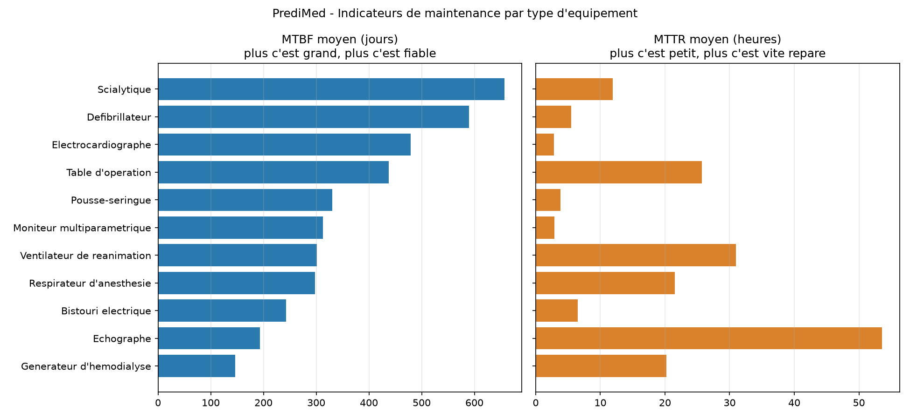
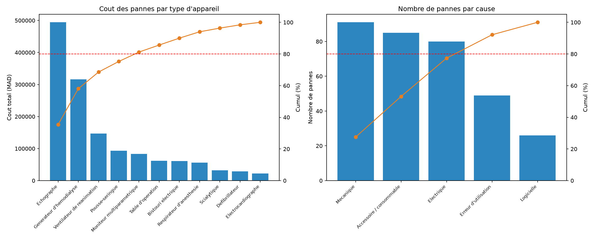
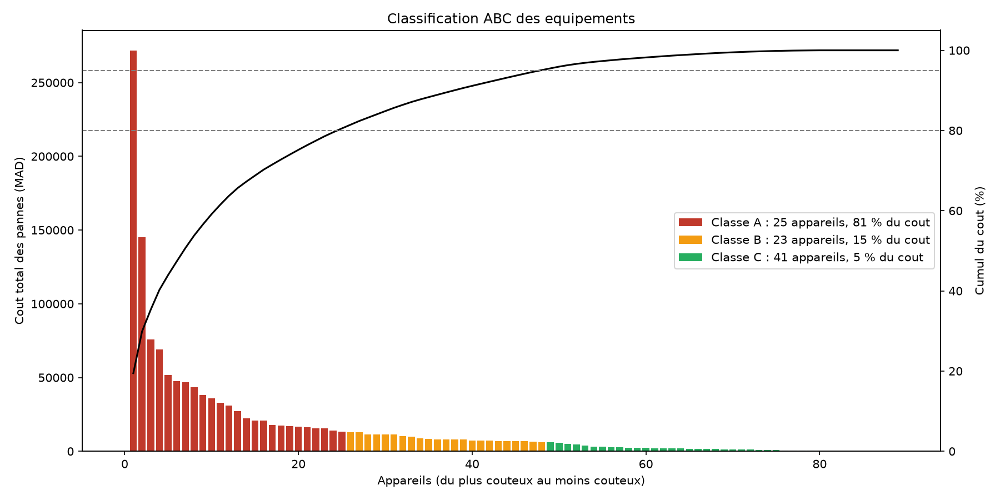
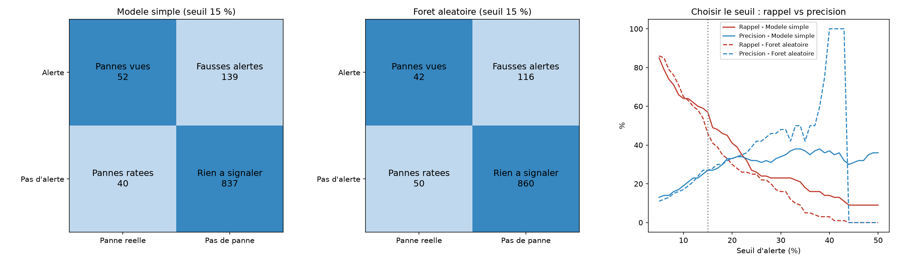
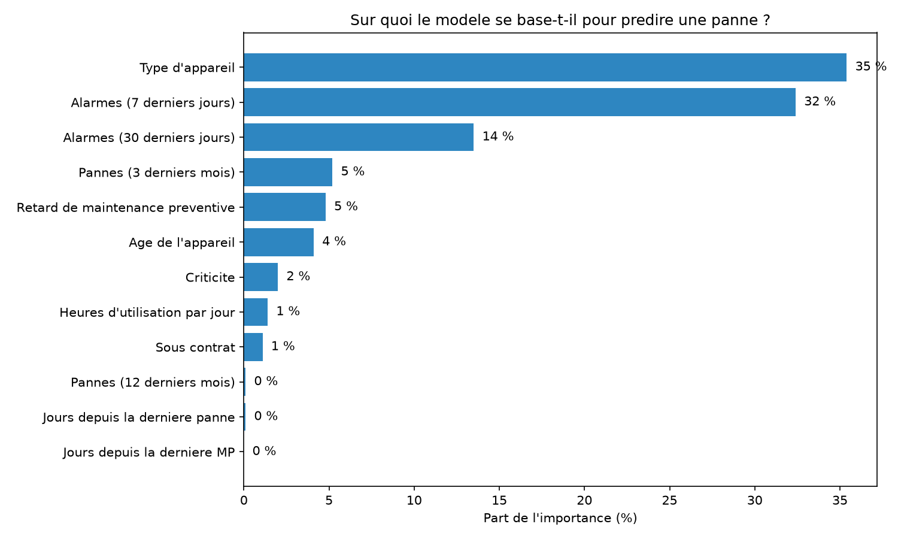

# PrediMed – Maintenance prédictive des équipements biomédicaux

Projet personnel en Python : analyser la fiabilité d'un parc d'équipements biomédicaux
et **prédire les pannes à 30 jours** pour aider le service biomédical à prioriser ses interventions.

**Auteure :** Kenza Akouz – ingénieure biomédicale (option maintenance)

> ⚠️ Les données sont **simulées** : aucun hôpital réel n'est concerné. Le générateur s'appuie
> sur des hypothèses réalistes (taux de panne par type, âge, usage, contrat de maintenance,
> maintenance préventive, alarmes).

---

## Le problème

Dans un hôpital, une panne d'équipement (respirateur, générateur d'hémodialyse, échographe…)
retarde les soins et coûte cher. Le plus souvent, la maintenance est **corrective** (on répare
après la panne) ou **préventive selon un calendrier fixe**.

**Question du projet :** à partir de l'historique des pannes, des maintenances et des alarmes,
peut-on savoir **quels appareils vérifier en priorité le mois prochain** ?

## La démarche

| Phase | Contenu |
|---|---|
| 1-2. Données | Simulation d'un parc de **89 équipements** (11 types, 5 services) sur 3 ans (2023-2025) : pannes, maintenances préventives, alarmes |
| 3. Analyse | Indicateurs **MTBF, MTTR, disponibilité**, analyse de **Pareto** et **classification ABC** |
| 4. IA | Modèle de machine learning qui prédit le **risque de panne à 30 jours** de chaque appareil |
| 5. Tableau de bord | Page web interactive qui rassemble tous les résultats |

## Résultats principaux

### Fiabilité du parc (2023-2025)

- **303 pannes** sur 3 ans
- **MTBF du parc : 321 jours** – **MTTR : 19,7 h** – **disponibilité : 99,74 %**
- Le **générateur d'hémodialyse** est le type le plus fragile (MTBF le plus court)



### Où va le budget de maintenance ?

- **Pareto :** l'hémodialyse (26 %) et l'échographe (23 %) représentent à eux deux près de **la moitié du coût des pannes**
- **Classification ABC :** **26 appareils sur 89 (29 %)** concentrent **80 % du coût** → à suivre en priorité




### Prédiction des pannes à 30 jours

- Un **tableau d'exemples** : une « photo » de chaque appareil au 1er de chaque mois (3 204 lignes),
  avec uniquement les informations connues à cette date (pas de fuite de données)
- **Entraînement sur 2023-2024, test sur 2025** (données jamais vues par le modèle)
- Deux modèles comparés : **régression logistique** et **forêt aléatoire** → la régression logistique est retenue
- **Note de tri (AUC) : 0,75** sur 2025
- Au seuil d'alerte de 15 % : **57 % des pannes vues venir** (52 sur 92), en vérifiant environ 16 appareils par mois,
  soit **environ 3 fois plus efficace** qu'une vérification au hasard du même nombre d'appareils



### Sur quoi le modèle se base-t-il ?

Les signaux les plus utiles sont le **type d'appareil** (35 %) et les **alarmes récentes** (46 % au total),
suivis du retard de maintenance préventive et de l'âge.



**Recommandations pour le service biomédical :**
1. Suivre les alarmes des appareils : c'est le meilleur signal d'alerte
2. Renforcer la surveillance des types fragiles (hémodialyse, échographe)
3. Respecter le planning de maintenance préventive

### Liste d'action – janvier 2026

Le modèle final (ré-entraîné sur 2023-2025) produit la liste des **18 appareils à vérifier en janvier 2026**,
classés par risque, avec la raison de chaque alerte (ex. *« 2 alarmes cette semaine, MP en retard de 30 j »*).

## Tableau de bord

Le fichier `resultats/tableau_de_bord.html` rassemble les chiffres clés, la liste des appareils à vérifier
et les graphiques interactifs. Il s'ouvre dans n'importe quel navigateur, sans installation.

## Organisation du projet

```
PrediMed/
├── donnees/                 # données simulées (CSV)
├── scripts/
│   ├── generer_donnees.py      # 1. simulation du parc, des pannes, MP et alarmes
│   ├── apercu_donnees.py       # 2. contrôle qualité des données
│   ├── indicateurs.py          # 3. MTBF, MTTR, disponibilité
│   ├── pareto.py               # 4. analyse de Pareto
│   ├── classification_abc.py   # 5. classification ABC
│   ├── construire_dataset.py   # 6. tableau d'exemples pour l'IA
│   ├── entrainer_modeles.py    # 7. entraînement des modèles
│   ├── evaluer_modeles.py      # 8. évaluation (rappel, précision, AUC)
│   ├── importance_indices.py   # 9. importance des indices
│   ├── predire_risques.py      # 10. liste des appareils à risque
│   └── tableau_de_bord.py      # 11. tableau de bord HTML
├── modeles/                 # modèles entraînés
└── resultats/               # graphiques, tableaux, tableau de bord
```

## Lancer le projet

```bash
pip install -r requirements.txt
python scripts/generer_donnees.py
python scripts/indicateurs.py
# ... puis les autres scripts dans l'ordre ci-dessus
python scripts/tableau_de_bord.py
```

## Outils

Python · pandas · NumPy · matplotlib · scikit-learn · Plotly

## Limites

- Les données sont simulées : le modèle apprend les règles du générateur. Sur des données réelles
  (GMAO de l'hôpital, journaux d'alarmes des équipements), les performances seraient à revalider.
- Une partie des pannes (erreurs d'utilisation) arrive sans signe avant-coureur et ne peut pas être prédite.